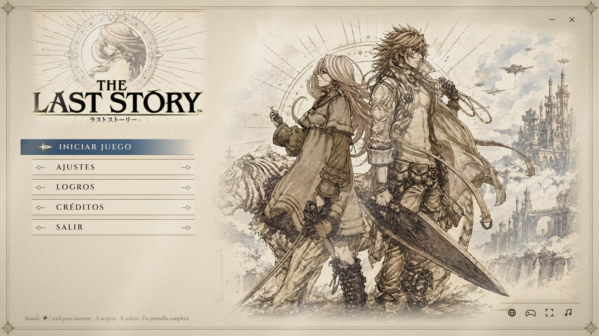
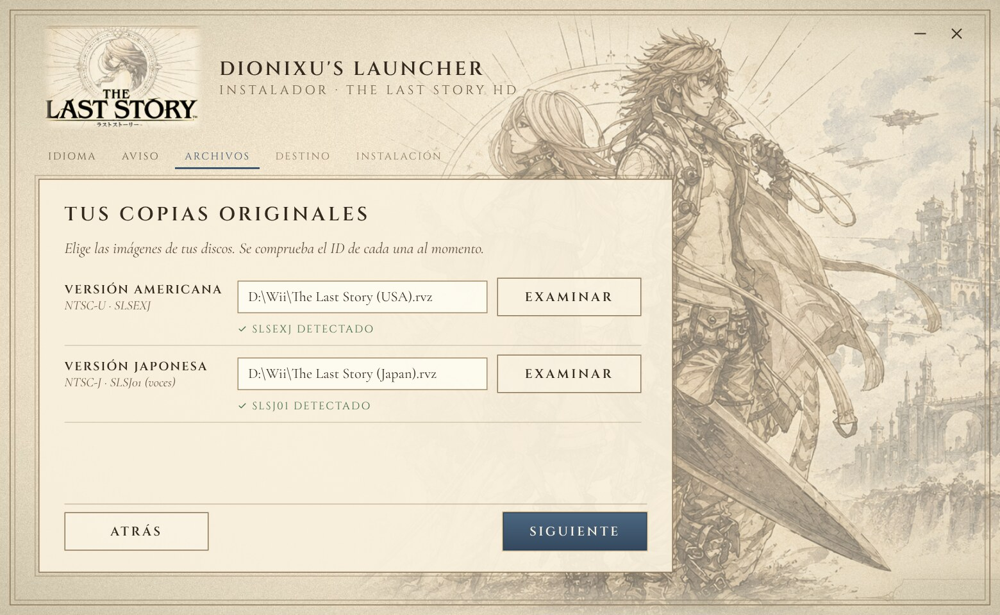
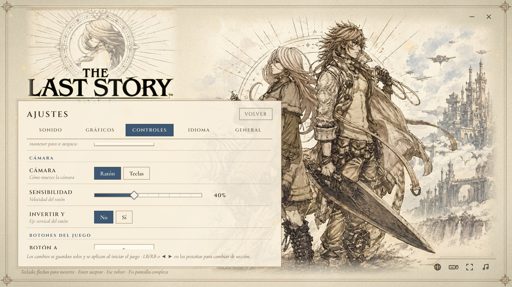
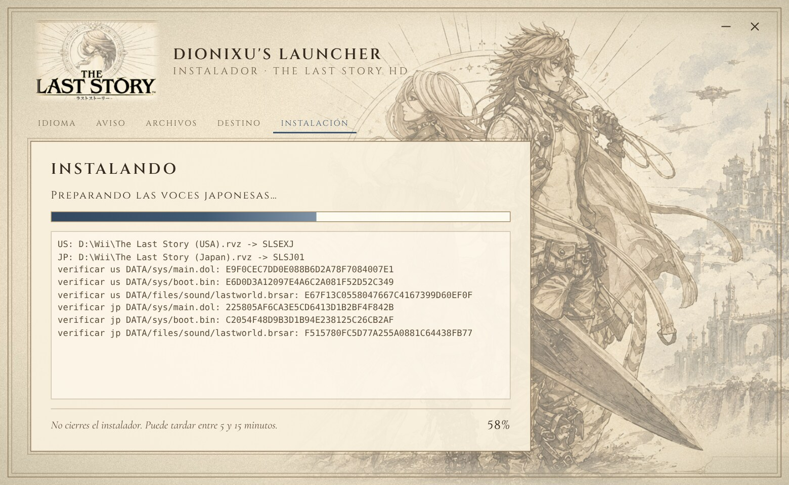
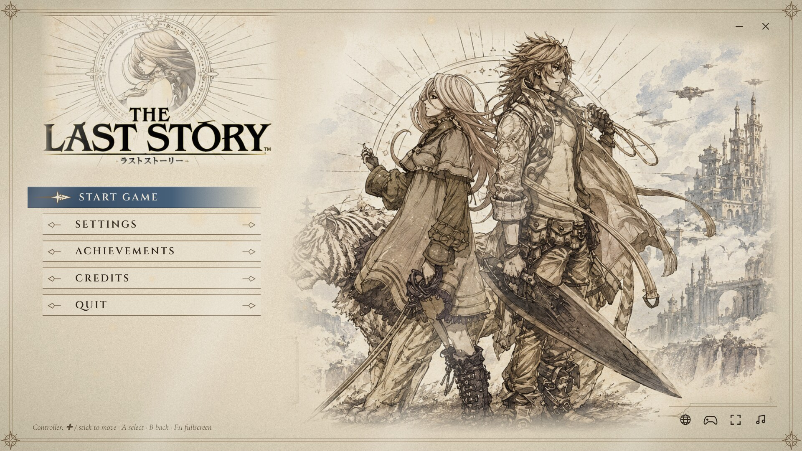
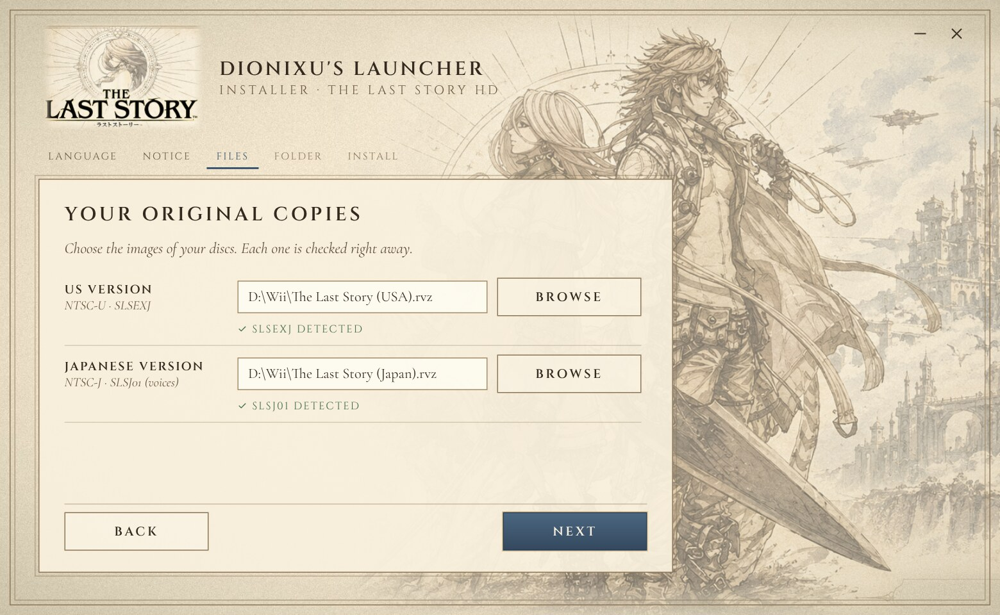
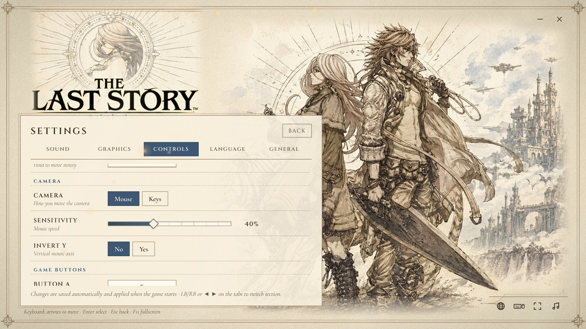
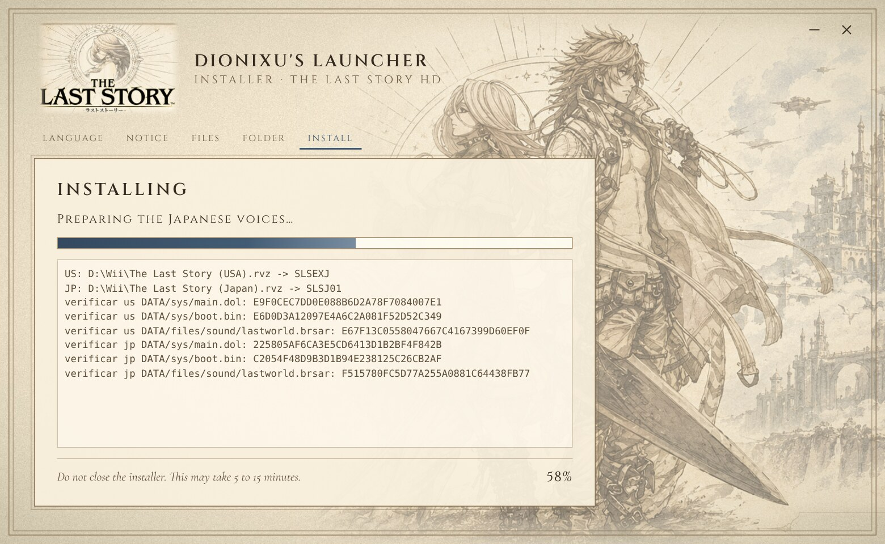

# TLSHD Launcher — The Last Story HD (Dionixu's Launcher)

> I made this cuz it was my childhood dream.

[](https://ko-fi.com/dionixu838824)

Launcher e instaladores para Windows y Linux que convierten **tu copia original** de *The Last Story* (Wii) en una experiencia de PC: texturas HD, 60 FPS adaptativos, voces japonesas, logros sin conexión, controles configurables y menú de pausa.

**Español** · [English](#english) · [Français](#français)

---

## ⚠️ Aviso legal

- Este proyecto **NO incluye el juego**.
- Necesitas **dos copias originales** de *The Last Story* para Wii, extraídas por ti de tus propios discos:
  - versión americana (NTSC-U, `SLSEXJ`);
  - versión japonesa (NTSC-J, `SLSJ01`).
- El instalador comprueba ambas copias (ID y huellas MD5) y **solo funcionará con tu copia oficial**. Rechaza las copias modificadas, incompletas o de otra región.
- **No se acepta ni se fomenta la piratería.** Necesitas tu copia oficial.
- Es un proyecto de aficionados sin fines de lucro, sin relación con Nintendo, Mistwalker ni AQ Interactive.

## Funciones

- Launcher con el estilo del juego, en español, inglés y francés (se cambia con el icono del globo).
- Texturas HD e iconos de botones de Xbox, Wii o teclado y ratón (QWERTY y ratón de 5 botones).
- 60 FPS adaptativos: baja a 30 FPS cuando el juego no los sostiene y vuelve a 60 después.
- Voces japonesas, también en las cinemáticas, con subtítulos en el idioma elegido.
- Logros de RetroAchievements evaluados sin conexión. El launcher no guarda ni la contraseña ni el token.
- Configuración de mando y de teclado y ratón.
- Menú de pausa con L3 + R3 o Esc, con volumen del juego en vivo y opción de volver al launcher.
- Ventana sin bordes, cursor personalizado y sin la pantalla de la correa del Wiimote.

## Capturas

| Launcher | Instalador |
|---|---|
|  |  |
|  |  |

## Descargas

Los instaladores están en **Releases**:
- `TLSHD LAUNCHER WINDOWS.rar`: Windows 10/11.
- `TLSHD LAUNCHER LINUX.rar`: Debian 12, Ubuntu 22.04, Mint 21 o más nuevos.

## Instalación

Primero hay que generar los instaladores en Windows. Ejecuta:

```
scripts\12_CREAR_INSTALADORES.bat
```

El script crea `Documentos\The Last Story HD PC\INSTALADOR\Windows` y `\Linux`.

- **Windows:** sigue `instalador/docs/INSTRUCCIONES_Windows.txt`. Se abre con `Instalar The Last Story HD.exe`.
- **Linux** (Debian 12, Ubuntu 22.04, Mint 21 o más nuevos): sigue `instalador/docs/INSTRUCCIONES_Linux.txt`. Se abre con `bash instalar.sh`. Necesitas tu propio Dolphin, instalado con `apt` o con Flatpak.

## Agregar a Steam (opcional, Windows y Linux)
En la carpeta [`steam/`](steam/) está **`AGREGAR_A_STEAM.bat`**: copia `AGREGAR_A_STEAM.bat`, `AGREGAR_A_STEAM.ps1` y la carpeta `arte` dentro de la carpeta del juego y haz doble clic. Agrega el juego a Steam como *juego que no es de Steam* con portada, fondo, logo e icono, para **cualquier usuario de Steam** del PC (si no encuentra el juego, te deja elegir el `.exe`). Si ya estaba agregado solo lo actualiza, sin perder tu tiempo de juego. Si el mando no responde: *clic derecho al juego → Propiedades → Mando → Desactivar Steam Input*.

**Linux / Steam Deck:** el `.bat` es solo de Windows. En Linux usa **`agregar_a_steam.sh`** (misma carpeta [`steam/`](steam/), necesita Python 3, que ya viene en casi todas las distribuciones y en Steam Deck): el instalador lo deja en la carpeta del juego; si no, copia `agregar_a_steam.sh`, `agregar_a_steam.py` y `arte` ahí. Luego, en una terminal dentro de la carpeta del juego: `./agregar_a_steam.sh`. Hace lo mismo que el `.bat` (portada, fondo, logo, icono, todos los usuarios; funciona con Steam nativo, Flatpak y Steam Deck en modo escritorio).

## Estructura

| Carpeta | Contenido |
|---|---|
| `launcher/resources/app/` | Proceso principal (`main.js`, multiplataforma), puente de mando para Windows (`bridge.ps1`) y motor de logros y FPS (`tls_logros.exe`) |
| `launcher/ui/` | Interfaz del launcher, menú de pausa y notificaciones |
| `launcher/data/` | Sets de botones (xbox, wii, teclado) y traducciones de los logros |
| `instalador/` | Instalador (Electron), `instalar.sh` para Linux e instrucciones |
| `linux/` | `tls_bridge` (mando, Esc, foco, ventana sin bordes) y `tls_logros` para Linux |
| `herramientas/` | Código fuente en C de los motores y scripts de análisis |
| `scripts/` | Pasos reproducibles: extraer, preparar, parche de voces, logros, empaquetado e instaladores |

## ☕ Apoya el proyecto

Si te gustó y quieres apoyarme, puedes invitarme un café en Ko-fi: **https://ko-fi.com/dionixu838824**

## Créditos

- **Proyecto:** Dionixu's Launcher, por Dionixu ([@kaiwolft](https://github.com/kaiwolft)).
- **Desarrollado con la ayuda de Claude** (Anthropic), que escribió el código junto a Dionixu: launcher, instaladores, motores de logros y 60 FPS, y el puente de Linux.
- **Porting Linux y correcciones de controles:** daetrox ([@daetrox](https://github.com/daetrox)) — Diagnóstico y corrección de problemas de visualización Wayland/X11, mapeo de mandos genéricos (DirectInput), detección de teclado y estabilidad de foco en Dolphin.
- **Texturas HD:** pack HD de Matrix2525.
- **Botones Xbox:** pack de botones Xbox, adaptado.
- **Dolphin Emulator** (GPLv2): [dolphin-emu.org](https://dolphin-emu.org).
- **Electron** (MIT): [electronjs.org](https://www.electronjs.org).
- **rcheevos / RetroAchievements** (MIT). Set de logros por carlosrhv y Quenthel.
- **Código Gecko de 60 FPS:** Dolphin Wiki. Mejoras visuales: sergx12.
- **Fuentes:** Cinzel y Cormorant Garamond (SIL OFL).
- **Música del launcher:** «Toberu mono».
  - Compositor: Nobuo Uematsu.
  - Voz: Kanon.
  - Arreglo: Yoshitaka Suzuki.
  - Fuente: *The Last Story Original Soundtrack* (Dog Ear Records, DERP-10012/4).
- **Sonidos del menú:** efectos de sonido de *The Last Story*.
- *The Last Story* © Nintendo / Mistwalker / AQ Interactive.

> **Derechos:**
> - Es un homenaje de fans sin fines de lucro.
> - La música, los sonidos, el arte, los logotipos y las marcas pertenecen a sus respectivos dueños. Se usan sin intención de infringir.
> - Si eres titular de algún contenido y quieres que se retire, abre un *issue* en este repositorio o escribe por Ko-fi y se quitará de inmediato.

---

## English

Launcher and Windows/Linux installers that turn **your original copy** of *The Last Story* (Wii) into a PC experience:

- HD textures;
- adaptive 60 FPS;
- Japanese voices;
- offline achievements;
- remappable controls;
- a pause menu.

**Legal notice:**

- The game is **not included**.
- You need your own **original North American (`SLSEXJ`) and Japanese (`SLSJ01`)** copies.
- The installer verifies both and will **only work with your official copy**.
- **Piracy is not accepted or encouraged.**

To build the installers, run `scripts\12_CREAR_INSTALADORES.bat` on Windows. Then follow `instalador/docs/INSTRUCCIONES_*.txt`.

☕ **Buy me a coffee:** https://ko-fi.com/dionixu838824

**Credits:** Dionixu's Launcher by Dionixu. **Built with the help of Claude (Anthropic).** **Linux porting & controller fixes:** daetrox ([@daetrox](https://github.com/daetrox)). HD pack by Matrix2525. Launcher music: “Toberu mono” by Nobuo Uematsu (vocals: Kanon, arrangement: Yoshitaka Suzuki), from *The Last Story Original Soundtrack* (Dog Ear Records). Also Dolphin, Electron and rcheevos/RetroAchievements. *The Last Story* © Nintendo / Mistwalker / AQ Interactive. Non-profit fan tribute: all music, sounds, artwork and trademarks belong to their owners, and rights holders can request removal through an issue.

### Add to Steam (optional, Windows and Linux)
The [`steam/`](steam/) folder contains **`AGREGAR_A_STEAM.bat`**: copy `AGREGAR_A_STEAM.bat`, `AGREGAR_A_STEAM.ps1` and the `arte` folder into the game folder and double-click it. It adds the game to Steam as a *non-Steam game* with cover, background, logo and icon, for **any Steam account** on the PC (if it cannot find the game it lets you pick the `.exe`). If it was already added it is only updated, keeping your play time. If the controller does not respond: *right-click the game → Properties → Controller → Disable Steam Input*.

**Linux / Steam Deck:** the `.bat` is Windows-only. On Linux use **`agregar_a_steam.sh`** (same [`steam/`](steam/) folder, needs Python 3, already present on most distros and on Steam Deck): the installer puts it in the game folder; otherwise copy `agregar_a_steam.sh`, `agregar_a_steam.py` and `arte` there. Then, in a terminal inside the game folder: `./agregar_a_steam.sh`. Same result as the `.bat` (cover, background, logo, icon, all accounts; native Steam, Flatpak Steam and Steam Deck desktop mode).

### Screenshots

| Launcher | Installer |
|---|---|
|  |  |
|  |  |

## Français

Launcher et installateurs Windows/Linux qui transforment **ta copie originale** de *The Last Story* (Wii) en expérience PC :

- textures HD ;
- 60 FPS adaptatifs ;
- voix japonaises ;
- succès hors ligne ;
- commandes configurables ;
- menu pause.

**Avertissement :**

- Le jeu **n'est pas inclus**.
- Il te faut tes **copies originales américaine (`SLSEXJ`) et japonaise (`SLSJ01`)**.
- L'installateur les vérifie et **fonctionne uniquement avec ta copie officielle**.
- **Le piratage n'est ni accepté ni encouragé.**

☕ **Offre-moi un café :** https://ko-fi.com/dionixu838824

**Crédits :** Dionixu's Launcher par Dionixu. **Développé avec l'aide de Claude (Anthropic).** **Portage Linux & corrections de contrôles :** daetrox ([@daetrox](https://github.com/daetrox)). Pack HD de Matrix2525. Musique du launcher : « Toberu mono » de Nobuo Uematsu (voix : Kanon, arrangement : Yoshitaka Suzuki), tirée de *The Last Story Original Soundtrack* (Dog Ear Records). Aussi Dolphin, Electron et rcheevos/RetroAchievements. Hommage de fans à but non lucratif : la musique, les sons, les illustrations et les marques appartiennent à leurs propriétaires.

### Ajouter à Steam (optionnel, Windows et Linux)
Le dossier [`steam/`](steam/) contient **`AGREGAR_A_STEAM.bat`** : copiez `AGREGAR_A_STEAM.bat`, `AGREGAR_A_STEAM.ps1` et le dossier `arte` dans le dossier du jeu, puis double-cliquez. Le jeu est ajouté à Steam (*jeu non-Steam*) avec jaquette, fond, logo et icône, pour **n'importe quel compte Steam** du PC. Si la manette ne répond pas : *clic droit sur le jeu → Propriétés → Manette → Désactiver Steam Input*.

**Linux / Steam Deck :** le `.bat` est réservé à Windows. Sous Linux, utilisez **`agregar_a_steam.sh`** (même dossier [`steam/`](steam/), nécessite Python 3) : copiez `agregar_a_steam.sh`, `agregar_a_steam.py` et `arte` dans le dossier du jeu si l'installateur ne l'a pas fait, puis lancez `./agregar_a_steam.sh` dans un terminal depuis ce dossier.
